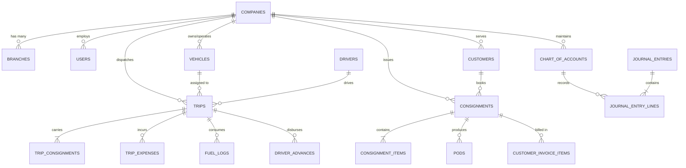

# GOODS TRANSPORT MANAGEMENT SYSTEM (TMS) — DATABASE AUDIT & SPECIFICATIONS
**Document Reference:** TMS-DBA-001  
**Phase:** Phase 0 — Audit & Development Planning  
**Audit Date:** November 10, 2026  
**Database Engine:** MySQL 8.4.7 / MariaDB 11.4.9 (InnoDB)  
**Status:** SCHEMA SPECIFICATION COMPLETE — AWAITING MIGRATION APPROVAL  

---

## 1. Executive Summary & Existing Database State

An inspection of the local database servers (`MySQL 8.4.7` on Port 3306 and `MariaDB 11.4.9` on Port 3307) reveals that:
- **No dedicated database schema exists** for the Goods Transport Management System (`tms`).
- **0 tables or migrations** currently exist for TMS in `C:\wamp64\www\TMS\database\migrations`.
- Existing databases in the WAMP instance (`laravel`, `marquee`, `mcms`, `textile_pos`, `foodpoint_pos`) belong to other business systems and must not be used or modified.

Because the project is starting from a clean slate, this document defines the **Definitive Database Standards, Foreign Key Hierarchies, Indexing Rules, Financial Precisions, and Integrity Constraints** required to avoid the architectural debt observed in legacy enterprise systems.

---

## 2. Core Architectural Database Rules

### 2.1 Multi-Tenant & Branch Scoping Columns
Every business entity and transactional table (except platform-level tables like `companies` and `subscription_plans`) **MUST** include:
1. `company_id BIGINT UNSIGNED NOT NULL`: Foreign key referencing `companies(id)` with `ON DELETE RESTRICT`.
2. `branch_id BIGINT UNSIGNED NULL`: Foreign key referencing `branches(id)` with `ON DELETE RESTRICT` (Nullable for company-wide master records, mandatory for branch-level operational documents like Bilties/Consignments and Trips).

### 2.2 Financial Data Types — Strict Zero-Loss Rule
- **NEVER use `FLOAT`, `DOUBLE`, or `INTEGER` for money or rates.**
- **All monetary fields** (`freight_amount`, `advance_amount`, `diesel_cost`, `toll_tax`, `demurrage`, `subtotal`, `tax_amount`, `total_amount`, `debit`, `credit`, `balance`) **MUST use `DECIMAL(15, 2)`**.
- **Unit freight rates and fuel price per liter** **MUST use `DECIMAL(12, 4)`** to eliminate fractional rounding discrepancies over large quantities or tonnage.
- **Weights and Tonnage** (`gross_weight`, `tare_weight`, `net_weight`, `chargeable_weight`) **MUST use `DECIMAL(10, 3)`** (allowing gram-level accuracy in metric tons).
- **Quantities** (`packages_count`, `units`) **MUST use `DECIMAL(12, 2)`** to accommodate fractional units (e.g., cubic meters, bags, liters).

### 2.3 Audit Columns & Soft Deletes
All master and transactional tables **MUST** contain:
- `created_by BIGINT UNSIGNED NULL` -> foreign key `users(id)`
- `updated_by BIGINT UNSIGNED NULL` -> foreign key `users(id)`
- `deleted_by BIGINT UNSIGNED NULL` -> foreign key `users(id)`
- `created_at TIMESTAMP NULL`
- `updated_at TIMESTAMP NULL`
- `deleted_at TIMESTAMP NULL` (Laravel `SoftDeletes`)

### 2.4 Deletion & Cascade Safety
- **STRICT RULE**: `ON DELETE CASCADE` is **strictly prohibited** on primary business entities (`customers`, `vehicles`, `drivers`, `consignments`, `trips`, `invoices`, `journal_entries`).
- Accidental cascade deletion of a customer or vehicle must never wipe out legal transport bilties, historical trips, or audited accounting ledger entries.
- All foreign keys to parent entities must declare `ON DELETE RESTRICT`.
- `ON DELETE CASCADE` is only permissible on internal dependent child lines (e.g. `consignment_items` or `quotation_items`) when and only when the parent document is in `draft` status and has not generated accounting entries.

---

## 3. Comprehensive Entity-Relationship Schema Map

---

## 4. Entity Table Matrix & Identification of Improvement Requirements

The following table matrix identifies the target schema required for Phase 1 migrations:

| Entity Domain | Table Name | Key Columns | Financial Precision | Unique Constraints | Critical Indexes | Cascade Behavior |
| :--- | :--- | :--- | :--- | :--- | :--- | :--- |
| **SaaS & Tenant** | `companies` | `id, name, slug, email, phone, status` | N/A | `UNIQUE(slug)` | `INDEX(status)` | `RESTRICT` |
| **SaaS & Tenant** | `branches` | `id, company_id, code, name, city, phone` | N/A | `UNIQUE(company_id, code)` | `INDEX(company_id, city)` | `RESTRICT` |
| **SaaS & Tenant** | `users` | `id, company_id, branch_id, name, email, password, role` | N/A | `UNIQUE(email)` | `INDEX(company_id, branch_id)` | `RESTRICT` |
| **Customer** | `customers` | `id, company_id, name, code, contact_person, phone, tax_number, credit_limit, balance` | `DECIMAL(15,2)` | `UNIQUE(company_id, code)` | `INDEX(company_id, name)` | `RESTRICT` |
| **Fleet & Owners** | `vehicle_owners` | `id, company_id, name, cnic, phone, address, bank_details, balance` | `DECIMAL(15,2)` | `UNIQUE(company_id, cnic)` | `INDEX(company_id, name)` | `RESTRICT` |
| **Fleet & Vehicles**| `vehicles` | `id, company_id, owner_id, vehicle_number, vehicle_type, ownership_type, capacity_ton` | `DECIMAL(10,3)` | `UNIQUE(company_id, vehicle_number)`| `INDEX(company_id, owner_id)` | `RESTRICT` |
| **Fleet & Drivers** | `drivers` | `id, company_id, name, license_number, license_expiry, cnic, phone, status` | N/A | `UNIQUE(company_id, license_number)`| `INDEX(company_id, status)` | `RESTRICT` |
| **Rates & Contracts**| `customer_rates` | `id, company_id, customer_id, origin_city, destination_city, rate_type, rate, min_weight`| `DECIMAL(12,4)` | `UNIQUE(company_id, customer_id, origin_city, destination_city, rate_type)` | `INDEX(company_id, customer_id)` | `RESTRICT` |
| **Consignments** | `consignments` | `id, company_id, branch_id, consignment_number, booking_date, customer_id, consignor, consignee, origin, destination, freight_charges, total_amount, payment_mode, status` | `DECIMAL(15,2)` | `UNIQUE(company_id, consignment_number)` | `INDEX(company_id, customer_id, status)` | `RESTRICT` |
| **Consignments** | `consignment_items`| `id, consignment_id, description, package_type, quantity, actual_weight, chargeable_weight, rate, amount` | `DECIMAL(12,4) & DECIMAL(15,2)` | N/A | `INDEX(consignment_id)` | `CASCADE` (Line item only) |
| **Trip Dispatch** | `trips` | `id, company_id, branch_id, trip_number, trip_date, vehicle_id, driver_id, origin, destination, hire_cost, total_advance, status` | `DECIMAL(15,2)` | `UNIQUE(company_id, trip_number)` | `INDEX(company_id, vehicle_id, status)` | `RESTRICT` |
| **Trip Dispatch** | `trip_consignments`| `id, trip_id, consignment_id, order_sequence` | N/A | `UNIQUE(trip_id, consignment_id)` | `INDEX(consignment_id)` | `RESTRICT` |
| **Trip Operations** | `driver_advances` | `id, company_id, trip_id, driver_id, amount, payment_mode, payment_date, notes` | `DECIMAL(15,2)` | N/A | `INDEX(trip_id, driver_id)` | `RESTRICT` |
| **Trip Operations** | `fuel_logs` | `id, company_id, trip_id, vehicle_id, vendor_id, slip_number, liters, rate_per_liter, total_cost, odometer_reading` | `DECIMAL(12,4) & DECIMAL(15,2)` | `UNIQUE(company_id, slip_number)` | `INDEX(trip_id, vehicle_id)` | `RESTRICT` |
| **Trip Operations** | `trip_expenses` | `id, company_id, trip_id, expense_type, amount, paid_by, receipt_number, notes` | `DECIMAL(15,2)` | N/A | `INDEX(trip_id, expense_type)` | `RESTRICT` |
| **Delivery & POD** | `pods` | `id, company_id, consignment_id, received_date, receiver_name, receiver_phone, pod_file_path, status, remarks` | N/A | `UNIQUE(consignment_id)` | `INDEX(company_id, status)` | `RESTRICT` |
| **Customer Billing**| `customer_invoices`| `id, company_id, branch_id, invoice_number, invoice_date, due_date, customer_id, subtotal, tax_amount, total_amount, paid_amount, balance_amount, status` | `DECIMAL(15,2)` | `UNIQUE(company_id, invoice_number)`| `INDEX(company_id, customer_id, status)`| `RESTRICT` |
| **Customer Billing**| `customer_payments`| `id, company_id, invoice_id, customer_id, payment_date, payment_method, reference_no, amount, account_id` | `DECIMAL(15,2)` | `UNIQUE(company_id, reference_no)` | `INDEX(company_id, customer_id)` | `RESTRICT` |
| **Owner Settlement**| `owner_settlements`| `id, company_id, settlement_number, settlement_date, owner_id, total_freight, total_advances, total_deductions, net_payable, paid_amount, status` | `DECIMAL(15,2)` | `UNIQUE(company_id, settlement_number)` | `INDEX(company_id, owner_id, status)` | `RESTRICT` |
| **Double-Entry COA**| `chart_of_accounts`| `id, company_id, account_code, account_name, account_type, parent_id, is_group, current_balance, is_active` | `DECIMAL(15,2)` | `UNIQUE(company_id, account_code)` | `INDEX(company_id, account_type)` | `RESTRICT` |
| **General Ledger** | `journal_entries` | `id, company_id, voucher_number, voucher_type, voucher_date, reference_type, reference_id, narration, total_debit, total_credit, is_posted` | `DECIMAL(15,2)` | `UNIQUE(company_id, voucher_number)`| `INDEX(company_id, voucher_date)` | `RESTRICT` |
| **General Ledger** | `journal_entry_lines`| `id, journal_entry_id, account_id, debit, credit, memo` | `DECIMAL(15,2)` | N/A | `INDEX(journal_entry_id, account_id)` | `RESTRICT` |

---

## 5. Critical Database Deficiencies Prevented by Design

1. **No Mixed Float/Double Currency Columns**: By mandating `DECIMAL(15,2)` on all amounts and `DECIMAL(12,4)` on rates, rounding leakages common in legacy logistics systems are eliminated.
2. **Preventing Cross-Tenant Document Duplication**: Consignment numbers (`consignment_number`), Trip numbers (`trip_number`), and Invoices (`invoice_number`) are prefixed with company ID and enforced with a compound unique key (`UNIQUE(company_id, consignment_number)`).
3. **Atomic Document Sequence Counter**: A dedicated `document_sequences` table with pessimistic row-locking (`SELECT ... FOR UPDATE`) is required to generate strictly sequential, non-colliding Bilty and Invoice numbers even under high concurrent load.
4. **General Ledger Imbalance Prevention**: Check constraints and transactional validation ensuring `total_debit == total_credit` before persisting `journal_entries` to prevent broken financial ledgers.

