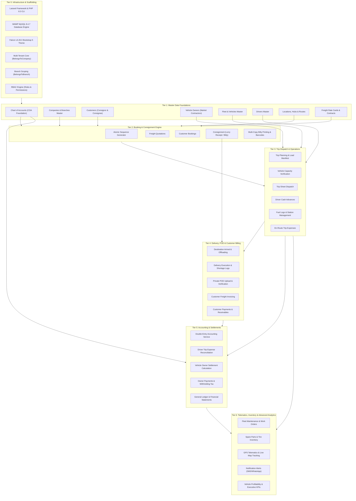

# GOODS TRANSPORT MANAGEMENT SYSTEM (TMS) — DEVELOPMENT DEPENDENCY MAP
**Document Reference:** TMS-DEP-001  
**Phase:** Phase 0 — Audit & Development Planning  
**Audit Date:** November 10, 2026  
**Status:** DEPENDENCY TOPOLOGY COMPLETE — AWAITING STAKEHOLDER APPROVAL  

---

## 1. Executive Summary

In a mission-critical Goods Transport Management System, operational modules are tightly coupled with financial and regulatory pipelines. Attempting to build transactional modules (e.g. Trips, Invoices, or Driver Advances) before foundational master data and accounting structures exist leads to severe architectural debt, database rework, and data corruption.

This document establishes the **Topological Dependency Graph** that governs the mandatory implementation sequence.

---

## 2. Topological Dependency Graph

---

## 3. Critical Architectural Coupling Analysis

### 3.1 Tenant & Branch Scoping Coupling
- **Prerequisite for:** Every single table, Eloquent query, and Livewire component.
- **Why it matters:** If `company_id` and `branch_id` traits are added retrospectively, hundreds of database queries and controller methods require refactoring to prevent severe cross-tenant data leaks.
- **Enforcement:** `BaseTenantModel` automatically applies `BelongsToCompany` global scope on `booted()`.

### 3.2 Fleet Ownership Model (Own vs Market Trucks)
- **Prerequisite for:** Trip Planning, Driver Advances, and Settlements.
- **Why it matters:** Transport operations use three distinct vehicle types:
  1. **Company-Owned Vehicles**: Depreciation, maintenance, fuel consumption, driver salary.
  2. **Dedicated / Attached Vehicles**: Fixed monthly or revenue-share agreement.
  3. **Market / Hired Trucks**: Per-trip hire cost paid to an external `VehicleOwner`. Requires advance deduction, diesel slips clearance, and net owner settlement vouchers.
- **Enforcement:** `ownership_type` column on `vehicles` determines the settlement and expense workflow.

### 3.3 Booking-to-Consignment Coupling
- **Prerequisite for:** Trip Manifests and Customer Billing.
- **Why it matters:** Quotations convert to Bookings, which generate legal **Consignments (Bilties)**. A Bilty is a legal contract of carriage and financial invoice precursor.
- **Enforcement:** An atomic sequence generator must assign immutable, consecutive Bilty numbers per company/financial year.

### 3.4 Trip Manifest & Dispatch Coupling
- **Prerequisite for:** Delivery, En-route Expenses, and POD.
- **Why it matters:** Multiple Consignments (LTL shipments) or a single bulk consignment (FTL) are bound to a single **Trip**. The Trip is the operational unit where driver advances and diesel slips are incurred.
- **Enforcement:** A Consignment cannot be dispatched on more than one active trip simultaneously.

### 3.5 Double-Entry Accounting Integration
- **Prerequisite for:** Financial statements, Customer balances, Owner balances, and Auditability.
- **Why it matters:** In logistics, operational actions are direct financial events:
  - *Bilty Issued (Paid/To-Pay/TBB)* -> Debit Accounts Receivable / Cash, Credit Freight Revenue.
  - *Driver Advance Disbursed* -> Debit Driver Advance (Asset), Credit Cash / Bank.
  - *Diesel Slip Issued* -> Debit Fuel Expense, Credit Fuel Vendor Payable.
  - *Market Vehicle Dispatched* -> Debit Truck Hire Expense, Credit Vehicle Owner Payable.
  - *Trip Reconciled* -> Offset Driver Advance against validated Trip Expenses; balance returned or reimbursed.
  - *Owner Settlement Finalized* -> Debit Owner Payable, Credit Advances, Credit Diesel, Credit Commission, Credit Bank.
- **Enforcement:** `AccountingService` encapsulates all journal creation inside database transactions, enforcing `sum(debits) === sum(credits)`.

---

## 4. Module Input-Output Data Flow Matrix

| Upstream Module | Generated Artifact / State | Consumed By Downstream Module | Downstream Action |
| :--- | :--- | :--- | :--- |
| **Customers & Contracts** | Agreed Rate Cards by Route & Weight Slab | **Quotations & Bookings** | Auto-calculates freight estimate. |
| **Bookings** | Verified Freight Cargo & Dimensions | **Consignment (Bilty)** | Generates official legal carriage document with atomic sequence number. |
| **Consignments** | Active Consignments staged at hub | **Trip Dispatch** | Aggregates consignments into vehicle manifest; verifies vehicle weight limit. |
| **Trip Dispatch** | Trip Sheet & Driver Cash Advance | **Trip Operations & Accounting** | Disburses advance voucher; opens en-route expense ledger. |
| **Trip Operations** | Diesel slips, Toll charges, Weighing receipts | **Trip Reconciliation** | Audits actual trip costs against driver advances. |
| **Trip Destination Arrival** | Offloaded Cargo Manifest | **Delivery & POD** | Triggers local delivery run or consignee warehouse offloading. |
| **Delivery Execution** | Signed Delivery Slip / Shortage Record | **POD Management** | Uploads scanned POD; updates consignment status to `Delivered`. |
| **POD Management** | Verified Scanned POD | **Customer Billing** | Unlocks consignment for invoicing; attaches POD to customer freight bill. |
| **Customer Billing** | Final Freight Invoice & Tax Breakdown | **Accounting (General Ledger)** | Posts Sales Invoice Journal Voucher; updates Customer Accounts Receivable. |
| **Trip Reconciliation** | Audited Trip Manifest & Expense Log | **Vehicle Owner Settlement** | Deducts advances & diesel from agreed truck hire freight; computes net payable. |
| **Owner Settlement** | Approved Owner Settlement Slip | **Accounting (General Ledger)** | Posts Settlement Journal Voucher; issues Bank Payment to Vehicle Owner. |

