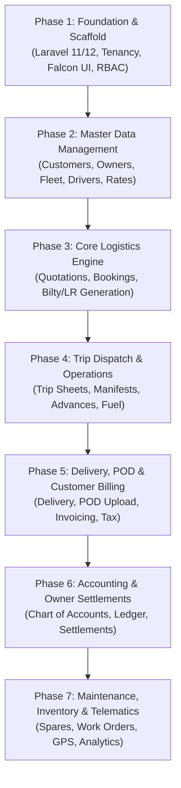

# GOODS TRANSPORT MANAGEMENT SYSTEM (TMS) — MASTER IMPLEMENTATION PLAN
**Document Reference:** TMS-PLN-001  
**Phase:** Phase 0 — Audit & Development Planning  
**Audit Date:** November 10, 2026  
**Status:** IMPLEMENTATION BLUEPRINT COMPLETE — AWAITING STAKEHOLDER APPROVAL  

---

## 1. Implementation Philosophy & Governance

This implementation plan establishes a disciplined, phased execution strategy. Each phase is strictly bounded by prerequisites and must satisfy automated verification criteria before proceeding to subsequent phases.

### Core Architecture Pillars:
1. **Multi-Tenant Foundation First**: Never implement business modules before the multi-tenant discriminator (`company_id`) and global query scopes are proven with unit tests.
2. **Double-Entry Financial Integrity**: Every operational event that alters wealth (freight booking, diesel issue, cash advance, repair cost) must trigger balanced journal entries in the General Ledger.
3. **Data Loss Zero-Tolerance**: All monetary numbers use `DECIMAL(15,2)`, rates use `DECIMAL(12,4)`, and all operational records employ soft deletes with foreign key `RESTRICT` rules.
4. **Isolated Private Storage**: Customer proofs of delivery, bills of lading, and driver identity scans must never sit in public web roots.

---

## 2. Phased Implementation Roadmap

---

## 3. Detailed Phase Breakdown & Effort Estimation

### Phase 1: Foundation, Multi-Tenancy Core, Falcon UI & RBAC
- **Objectives:**
  1. Initialize fresh Laravel skeleton configured for PHP 8.3.28 in `C:\wamp64\www\TMS`.
  2. Configure MySQL database connection (`tms_db`) on MySQL 8.4.7 (Port 3306).
  3. Integrate the local Falcon v3.26.0 Bootstrap 5 Admin Dashboard template and compile base assets with Vite.
  4. Build the multi-tenancy core traits (`BelongsToCompany`, `BelongsToBranch`) and middleware (`IdentifyTenant`, `VerifyBranchAccess`).
  5. Scaffolding custom Role-Based Access Control (RBAC): `Role`, `Permission`, `RolePermission`, `User`.
- **Key Deliverables:** Multi-tenant login, session isolation, tenant dashboard layout, user management.
- **Estimated Effort:** 18 - 24 Engineering Hours.

### Phase 2: Logistics Master Data Architecture
- **Objectives:**
  1. Customer (Consignor & Consignee) Master with credit limits, GST numbers, and branch links.
  2. Vehicle Owner Master (Third-party & Market truck contractors) with CNIC, bank details, and payment terms.
  3. Fleet & Vehicle Master (Own, Leased, Market) with payload weight/volume, body type, registration expiration.
  4. Driver Master with commercial license validation, expiry alerts, and phone contacts.
  5. Location & Route Master (Cities, Transshipment Hubs, Distance in KM, Standard Transit Times).
  6. Contract & Freight Rate Cards (Origin-Destination matrices, Weight slab rates, LTL/FTL pricing).
- **Key Deliverables:** Livewire CRUDs with tenant scoping, validation, search, and export.
- **Estimated Effort:** 24 - 30 Engineering Hours.

### Phase 3: Bookings & Consignment (LR / Bilty) Engine
- **Objectives:**
  1. Concurrency-safe atomic document sequence engine (`document_sequences` table with pessimistic row locks).
  2. Cargo Booking & Quotation conversion workflow.
  3. Consignment / Lorry Receipt (Bilty) generation with multi-package lines, insurance, and tax calculation.
  4. Multi-copy print generator (Consignor Copy, Consignee Copy, Driver/Transit Copy, Accounts Copy).
  5. Barcode / QR-code generation for instant consignment tracking.
- **Key Deliverables:** Bilty management interface, PDF generator with company branding, status state machine.
- **Estimated Effort:** 28 - 36 Engineering Hours.

### Phase 4: Trip Planning, Manifest & Fleet Dispatch
- **Objectives:**
  1. Trip Planning console: Grouping multiple consignments into a single vehicle loading manifest.
  2. Vehicle payload capacity validation (blocking overloading beyond legal limits).
  3. Trip Sheet generation with departure date, route, odometer reading, and driver assignment.
  4. Driver Advance disbursement (Cash, Bank Transfer, or Fuel Voucher).
  5. Fuel management: Logging diesel slips, fuel station vendor tracking, pump liters, and cost.
  6. En-route expense tracking: Tolls, police/challans, weighing fees, loading labor.
- **Key Deliverables:** Trip dispatch dashboard, vehicle capacity checker, driver advance register.
- **Estimated Effort:** 32 - 40 Engineering Hours.

### Phase 5: Delivery, POD Processing & Customer Invoicing
- **Objectives:**
  1. Destination Hub receiving and cargo offloading confirmation.
  2. Delivery execution: Logging delivery date, receiver name, phone, and shortages/damages.
  3. Private Proof of Delivery (POD) upload pipeline (scanned slip, receiver signature) with strict MIME validation.
  4. Authorized POD download gateway with permission checks.
  5. Freight Invoicing: Single Bilty invoice or consolidated monthly customer bill.
  6. Accounts Receivable tracking, payment receipts, and credit aging.
- **Key Deliverables:** POD verification console, Customer invoice generator, Aging schedule report.
- **Estimated Effort:** 26 - 34 Engineering Hours.

### Phase 6: Financial Accounting & Vehicle Owner Settlements
- **Objectives:**
  1. Standard 5-tier Chart of Accounts (Assets, Liabilities, Equity, Revenue, Expenses).
  2. Automated General Ledger double-entry engine (`AccountingService`).
  3. Automated Journal Voucher creation on:
     - Consignment Invoicing: Dr Customer Receivable, Cr Freight Revenue, Cr Tax Payable.
     - Trip Dispatch: Dr Truck Hire Expense, Cr Owner Payable; Dr Driver Advance, Cr Cash/Bank.
     - Fuel Issue: Dr Fuel Expense, Cr Fuel Station Payable / Cash.
     - Customer Payment: Dr Bank/Cash, Cr Customer Receivable.
  4. Vehicle Owner Settlement Engine: Calculating net payable (Agreed Freight - Advances - Diesel - Commission).
  5. Financial Reports: Trial Balance, General Ledger, Profit & Loss (by Company, Branch, and Vehicle).
- **Key Deliverables:** Complete accounting module, Owner settlement slips, Financial statements.
- **Estimated Effort:** 36 - 48 Engineering Hours.

### Phase 7: Fleet Maintenance, Inventory & Telematics
- **Objectives:**
  1. Vehicle scheduled maintenance triggers (kilometers run or calendar intervals).
  2. Workshop work orders and spare parts inventory tracking (tires, batteries, lubricants).
  3. GPS Telematics API integration for real-time truck position mapping and geofencing.
  4. Automated notification system (SMS / WhatsApp / Email) for dispatch and delivery milestones.
  5. Executive KPI dashboard: Fleet utilization rate, empty mileage percentage, revenue per ton-km.
- **Key Deliverables:** Maintenance scheduler, spare parts ledger, live fleet map, executive dashboard.
- **Estimated Effort:** 24 - 32 Engineering Hours.

---

## 4. Implementation Effort Summary

| Phase | Description | Estimated Hours | Target Sprints |
| :--- | :--- | :---: | :---: |
| **Phase 1** | Foundation, Multi-Tenancy Core, Falcon UI & RBAC | 20 - 24 hrs | Sprint 1 |
| **Phase 2** | Logistics Master Data Architecture | 26 - 30 hrs | Sprint 2 |
| **Phase 3** | Bookings & Consignment (LR / Bilty) Engine | 30 - 36 hrs | Sprint 3 |
| **Phase 4** | Trip Planning, Manifest & Fleet Dispatch | 34 - 40 hrs | Sprint 4 |
| **Phase 5** | Delivery, POD Processing & Customer Invoicing | 28 - 34 hrs | Sprint 5 |
| **Phase 6** | Financial Accounting & Vehicle Owner Settlements | 38 - 48 hrs | Sprint 6 |
| **Phase 7** | Maintenance, Inventory, GPS & Executive Analytics | 26 - 32 hrs | Sprint 7 |
| **TOTAL** | **Full TMS Implementation Scope** | **202 - 244 hrs** | **7 Sprints** |

---

## 5. Critical Risks & Architectural Mitigation Strategies

1. **Risk: Concurrent Bilty / Invoice Sequence Clashing**
   - *Mitigation:* Employ `DB::table('document_sequences')->lockForUpdate()` within atomic database transactions to guarantee continuous, zero-collision document sequences.
2. **Risk: Unbalanced General Ledger Entries**
   - *Mitigation:* Accounting service throws unhandled exception and rolls back entire database transaction if `sum(debit) != sum(credit)`.
3. **Risk: Cross-Tenant Data Leakage**
   - *Mitigation:* Global Eloquent query scope registered in abstract `BaseTenantModel` applied across every transactional entity, backed by automated Pest/PHPUnit tenant isolation tests.
4. **Risk: Accidental Cascade Deletion of Audited Records**
   - *Mitigation:* Explicit `ON DELETE RESTRICT` on all foreign key constraints for customers, vehicles, consignments, trips, and ledger entries.

