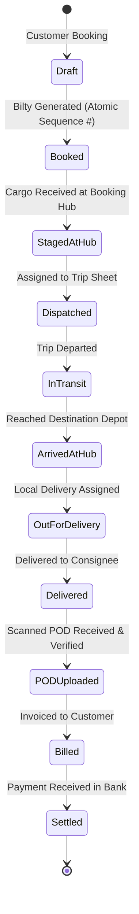
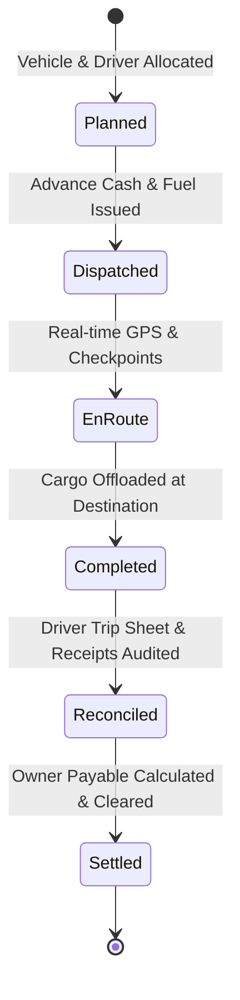

# GOODS TRANSPORT MANAGEMENT SYSTEM (TMS) — FUNCTIONAL MODULE STATUS AUDIT
**Document Reference:** TMS-MOD-001  
**Phase:** Phase 0 — Audit & Development Planning  
**Audit Date:** November 10, 2026  
**Status:** COMPLETE BASELINE AUDIT — AWAITING IMPLEMENTATION  

---

## 1. Classification Scheme

Every functional module is strictly audited and classified into one of the following five states:
- **`EXISTS AND VERIFIED`**: Module code exists, passes integration tests, is properly isolated by tenant/branch, and verified functional.
- **`EXISTS BUT INCOMPLETE`**: Module code is partially implemented (e.g. basic CRUD exists but lacks accounting, validation, or business flow hooks).
- **`EXISTS BUT DEFECTIVE`**: Module code exists but contains broken workflows, unhandled exceptions, IDOR flaws, or database corruption bugs.
- **`NOT IMPLEMENTED`**: No models, migrations, views, or business logic exist.
- **`BLOCKED BY DEPENDENCY`**: Module cannot be developed or verified until its prerequisite foundational modules and database schema are deployed.

---

## 2. Comprehensive Module Status Audit Matrix

| # | Functional Module | Current Classification | Immediate Dependencies | Key Required Components & Workflows |
| :---: | :--- | :--- | :--- | :--- |
| **01** | **SaaS Administration** | **`NOT IMPLEMENTED`** | Base Laravel Scaffold | Super Admin portal, tenant provisioning, company profile management, subscription plan definitions, billing intervals, feature flags. |
| **02** | **Company & Branch Management** | **`NOT IMPLEMENTED`** | SaaS Admin, Core Tenancy | Multi-company registration, branch/depot creation, branch codes, contact details, localized operational parameters, user-to-branch assignment. |
| **03** | **Fleet & Vehicles** | **`NOT IMPLEMENTED`** | Company & Branch Management, Vehicle Owners | Vehicle master, registration plates, chassis/engine numbers, vehicle types (Trailer, Flatbed, Container, Box Truck), capacity (weight & volume), ownership type (Own / Market / Attached). |
| **04** | **Vehicle Owners** | **`NOT IMPLEMENTED`** | Company Management, Chart of Accounts | Third-party / Market truck owner profiles, CNIC, banking coordinates, commission agreements, linked ledger accounts (Creditor/Payable). |
| **05** | **Drivers** | **`NOT IMPLEMENTED`** | Company & Branch Management | Driver registration, commercial license verification, license expiry alerts, emergency contacts, biometric/photo records, linked advance accounts. |
| **06** | **Customers** | **`NOT IMPLEMENTED`** | Company & Branch Management, Chart of Accounts | Consignor & Consignee profiles, tax registration (NTN/STRN), credit limits, payment terms (To-Pay / Paid / TBB - To Be Billed), linked Accounts Receivable. |
| **07** | **Contracts & Freight Rates** | **`NOT IMPLEMENTED`** | Customers, Fleet & Vehicle Types | Rate cards by route (Origin City -> Destination City), weight slab rates (Per Ton, Per Kg, Per Bag), full truckload (FTL) vs less than truckload (LTL) pricing, detention/demurrage rules. |
| **08** | **Quotations & Bookings** | **`NOT IMPLEMENTED`** | Customers, Contracts & Rates | Customer freight inquiries, rate quotation generation, quotation-to-booking conversion, cargo specifications, scheduled pickup dates. |
| **09** | **Consignments (LR / Bilty)** | **`NOT IMPLEMENTED`** | Bookings, Document Sequence Engine | Legal Lorry Receipt / Bilty generation, multi-item packaging lines, declared cargo value, transit insurance, print formats (Consignor, Consignee, Driver, Accounts copies). |
| **10** | **Trip Planning & Dispatch** | **`NOT IMPLEMENTED`** | Consignments, Vehicles, Drivers | Trip sheet creation, consolidating multiple consignments into a single vehicle manifest, route assignment, load verification, departure odometer reading. |
| **11** | **Delivery & POD** | **`NOT IMPLEMENTED`** | Trip Dispatch, Consignments | Destination arrival check-in, consignment delivery recording, shortage/damage notation, scanned Proof of Delivery (POD) upload, consignee signature, delivery acknowledgment. |
| **12** | **Fuel Management** | **`NOT IMPLEMENTED`** | Fleet & Vehicles, Trip Dispatch | Fuel slip logging, fuel station/vendor master, liters pumped, rate per liter, fuel station credit vs cash payment, vehicle mileage / fuel efficiency tracking (km/l). |
| **13** | **Trip Expenses** | **`NOT IMPLEMENTED`** | Trip Dispatch, Driver Advances, Accounting | En-route expense tracking (Toll plaza charges, police/challans, loading/labor charges, weighing scale fees, border taxes), receipt attachments, driver settlement. |
| **14** | **Maintenance** | **`NOT IMPLEMENTED`** | Fleet & Vehicles, Inventory & Spares | Scheduled maintenance reminders (oil change, tire replacement, engine overhaul), breakdown tickets, maintenance work orders, spare part consumption, workshop billing. |
| **15** | **Owner Settlements** | **`NOT IMPLEMENTED`** | Trips, Vehicle Owners, Accounting | Market/hired truck settlement calculation: Agreed trip hire freight minus driver trip advances minus fuel provided minus company commission = Net payable to owner. |
| **16** | **Customer Billing** | **`NOT IMPLEMENTED`** | Consignments, POD Verification, Accounting | Freight invoice generation (Single LR or Consolidated Monthly Bill), attaching verified PODs, tax/GST calculation, invoice dispatch, credit aging analysis. |
| **17** | **Accounting (Double-Entry GL)** | **`NOT IMPLEMENTED`** | Core Architecture, Financial Schema | Standard Transport Chart of Accounts, Journal Vouchers, auto-journal triggers on Bilty issue, Fuel issue, Trip expense, Invoice generation, and Payments. |
| **18** | **Inventory & Spares** | **`NOT IMPLEMENTED`** | Company & Branch Management | Depot warehouse management, spare parts catalog (tires, filters, engine oil, batteries), minimum stock reorder alerts, stock transfer between branches. |
| **19** | **Reports & Analytics** | **`NOT IMPLEMENTED`** | All Transactional Modules | Daily dispatch register, outstanding freight reports, vehicle profitability report, driver trip summary, route-wise margin analysis, Trial Balance, P&L, Balance Sheet. |
| **20** | **GPS & Mobile Integration** | **`NOT IMPLEMENTED`** | Fleet & Vehicles, Trip Dispatch | GPS tracker API integration (Teltonika, Concox, Traccar), real-time vehicle coordinate mapping, route deviations, speed alerts, driver mobile web check-in. |

---

## 3. Deep-Dive Audit of Core Functional Requirements

### 3.1 Consignment (LR / Bilty) Lifecycle

### 3.2 Trip Sheet & Fleet Settlement Lifecycle

---

## 4. Verification Evidence & Test Checklist

Because all modules are currently `NOT IMPLEMENTED`, the following automated test suites must be developed in Phase 1 before any module is marked `EXISTS AND VERIFIED`:

1. `TenantIsolationTest`: Verifies that queries issued by Company A never return records belonging to Company B.
2. `AtomicSequenceTest`: Verifies that concurrent Bilty creation requests never produce duplicate or skipped sequence numbers.
3. `TripConsignmentCapacityTest`: Verifies that total consignment weight assigned to a trip does not exceed vehicle legal payload capacity.
4. `DoubleEntryBalanceTest`: Verifies that every transaction logged through `AccountingService` has identical debit and credit totals.
5. `PodAccessAuthorizationTest`: Verifies that unauthenticated or cross-tenant users receive HTTP 403 when attempting to download POD files.
6. `OwnerSettlementMathTest`: Verifies accurate deduction of advances, diesel slips, and commissions from the gross trip hire amount.

