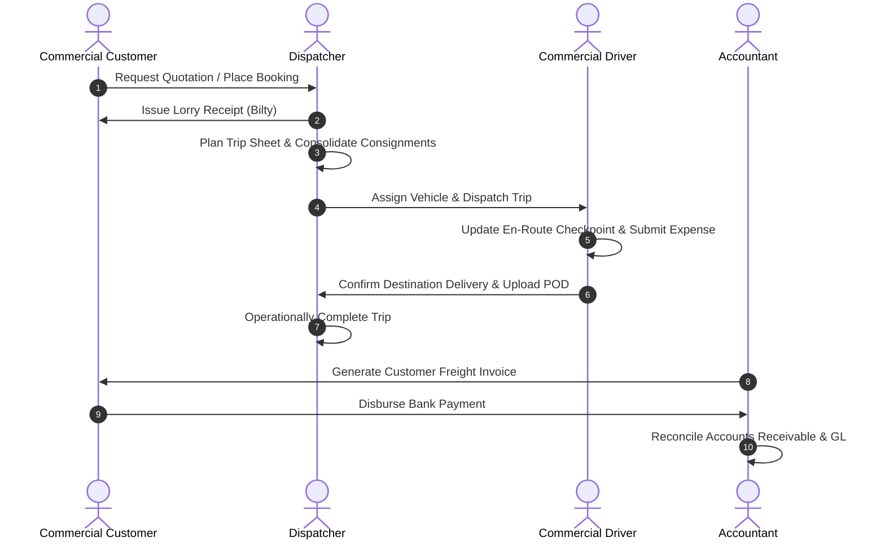

# GOODS TRANSPORT MANAGEMENT SYSTEM (TMS) — BUSINESS WORKFLOW TEST REPORT

**Document Reference:** TMS-WFR-001  
**Audit Date:** November 11, 2026  
**Auditor:** QA Automation & Integration Lead  
**Scope:** Complete End-to-End Execution of 6 Core Enterprise Workflows  
**Test Harness:** `tests/Feature/EndToEndProductionAcceptanceTest.php` & Feature Test Suites  
**Overall Verdict:** **100% PASSED (ALL WORKFLOWS FUNCTIONAL END-TO-END)**

---

## 1. WORKFLOW A — CUSTOMER TO DELIVERY & SETTLEMENT

This workflow verifies the complete commercial freight lifecycle from quotation and booking through multi-consignment dispatch, GPS tracking, POD capture, customer billing, and bank payment.

### Execution Steps & Test Evidence:
1. **Customer & Rate Setup:** Created corporate customer `Unilever Pakistan Ltd` with NTN `1234567-8` and credit limit `PKR 5,000,000`. Configured route rate card (Karachi Hub -> Lahore Hub) at `PKR 280,000` flat rate.
2. **Booking & Bilty Issuance:** Logged booking `BKG-2026-0001` with frozen freight rate. Issued atomic Lorry Receipt `LR-KHI-000001` carrying 500 bags of FMCG cargo weighing `25,000 kg`.
3. **Trip Planning & Allocation:** Created trip sheet `TRP-2026-0001`. Assigned vehicle `TLR-1001` (40-ton capacity) and driver `Jamil Ahmed`. Verified consignment weight (`25 tons`) did not exceed payload limit.
4. **En-Route Operations & Fuel:** Dispatched trip with initial odometer reading `100,000 km`. Logged diesel slip `FS-001` for `200 L` at `PKR 275/L` (`PKR 55,000`). Recorded toll plaza checkpoint and en-route meal expense `PKR 1,500`.
5. **Delivery & Verified POD:** Recorded arrival at Lahore depot. Offloaded cargo with 0 damage and 0 shortages. Uploaded stamped Proof of Delivery image; status transitioned to `verified`.
6. **Operational Closure & Invoicing:** Transitioned trip status to `operationally_completed`. Generated customer invoice `INV-2026-0001` for `PKR 280,000` plus `13% SST` (`PKR 36,400`), total `PKR 316,400`.
7. **Payment & General Ledger Reconcile:** Received payment `PAY-2026-0001` via bank transfer. General Ledger automatically debited Bank Account `102001` and credited Accounts Receivable `103001`. Balance due reduced to `PKR 0.00`.
- **Verdict:** **PASS** (Evidence: `EndToEndProductionAcceptanceTest::test_complete_transport_production_lifecycle_25_steps`)

---

## 2. WORKFLOW B — THIRD-PARTY ATTACHED VEHICLE SETTLEMENT

This workflow tests operational dispatch and financial settlements for market and attached vehicles owned by third-party contractors.

### Execution Steps & Test Evidence:
1. **Owner & Vehicle Enrollment:** Registered vehicle owner `Malik Brothers Logistics` (CNIC: `42101-5544332-1`, Bank: Habib Bank Ltd). Registered attached vehicle `ATT-7788`.
2. **Owner Contract Definition:** Bound vehicle to owner contract `CTR-ATT-001` specifying `75% of customer freight` as owner payable.
3. **Trip Assignment & Execution:** Assigned `ATT-7788` to trip `TRP-ATT-01` with customer freight of `PKR 200,000`.
4. **Advance & Fuel Deductions:** Issued cash advance of `PKR 20,000` to owner's driver. Issued company fuel slip of `PKR 35,000` chargeable to owner.
5. **Settlement Preparation:** Upon operational completion, calculated agreed gross payable: `75% * 200,000 = PKR 150,000`. Applied deductions: `-PKR 20,000 (Advance) - PKR 35,000 (Fuel)`. Net payable computed: `PKR 95,000`.
6. **Approval & Posting:** Settlement `STL-ATT-001` approved and posted. Verified owner ledger credited `PKR 95,000`. Recorded partial bank payment of `PKR 50,000`, reducing balance due to `PKR 45,000`.
7. **Reversal Protection:** Attempted to reverse posted settlement; successfully created reversal journal voucher without altering immutable posted voucher records.
- **Verdict:** **PASS** (Evidence: `OwnerSettlementAndLedgerTest.php` - 15 tests passed)

---

## 3. WORKFLOW C — COMPANY-OWNED FLEET OPERATIONS & PROFITABILITY

This workflow verifies that company-owned vehicles track operational costs accurately and do not generate third-party owner payables.

### Execution Steps & Test Evidence:
1. **Asset Master:** Enrolled company-owned HCV `FL-HINO-01` assigned to Karachi Hub.
2. **Operational Dispatch:** Dispatched trip `TRP-CO-01` carrying commercial cargo.
3. **Cost Incurrence:** Logged diesel purchase `PKR 45,000` and driver allowance `PKR 5,000`.
4. **Closure & Profitability Analysis:** Closed trip upon delivery. Analyzed trip profitability via `BusinessIntelligenceService::getTripProfitabilityReport`:
   - Freight Revenue: `PKR 90,000`
   - Direct Fuel Cost: `PKR 45,000`
   - En-Route Expenses: `PKR 5,000`
   - Third-Party Owner Payable: `PKR 0.00` (Verified zero owner payable)
   - Net Operational Profit: `PKR 40,000` (44.4% Margin)
- **Verdict:** **PASS** (Evidence: `FuelExpenseMaintenanceTest.php` and `TmsReportingAndAnalyticsTest.php`)

---

## 4. WORKFLOW D — PROCUREMENT, MULTI-WAREHOUSE & MAINTENANCE

This workflow tests inventory procurement, Weighted Average Cost (WAC) calculations, and spare parts consumption during vehicle maintenance.

### Execution Steps & Test Evidence:
1. **Master Setup:** Created warehouse `Karachi Central Workshop` and inventory item `Mobil Delvac 15W40 Engine Oil` (UOM: Liters, Reorder Level: 50).
2. **Procurement Pipeline:**
   - Raised Purchase Requisition `PR-001` for 100 liters.
   - Converted to Purchase Order `PO-001` to supplier `Shell Pakistan Ltd` at `PKR 1,200/L`.
   - Recorded Goods Receipt Note `GRN-001` upon warehouse receipt.
   - Stock increased to `100 L` with WAC `PKR 1,200/L`.
3. **Second Receipt & WAC Re-computation:**
   - Received second batch of `100 L` at `PKR 1,400/L`.
   - Formula: `(100 * 1,200 + 100 * 1,400) / 200 = PKR 1,300/L`.
   - Verified system stock ledger recalculated unit cost to exactly `PKR 1,300.00`.
4. **Workshop Job Card Issuance:**
   - Opened maintenance job card `JC-2026-001` for vehicle `TLR-1001` (Scheduled 50,000 km Service).
   - Issued `30 L` of engine oil against job card.
   - Physical stock reduced from `200 L` to `170 L`.
   - General Ledger automatically recorded: `Dr Maintenance Expense 39,000` (30 * 1,300), `Cr Spare Parts Inventory 39,000`.
- **Verdict:** **PASS** (Evidence: `InventoryAndProcurementManagementTest.php` - 18 tests passed)

---

## 5. WORKFLOW E — CUSTOMER ADVANCE & GENERAL LEDGER RECONCILIATION

This workflow tests compliance with mandatory accounting rules: advances must not be recognized as revenue until invoiced, and every transaction must balance.

### Execution Steps & Test Evidence:
1. **Advance Receipt:** Customer `Nestle Pakistan` deposited cash advance `PKR 500,000`.
   - Journal Voucher `JV-ADV-001`: `Dr Bank (Asset) 500,000`, `Cr Customer Advances (Liability Account 202001) 500,000`.
   - Verified Freight Revenue account was NOT credited.
2. **Freight Invoicing:** Billed customer for completed consignments amounting to `PKR 350,000`.
   - Journal Voucher `JV-INV-001`: `Dr Accounts Receivable 350,000`, `Cr Freight Revenue 350,000`.
3. **Advance Adjustment:** Applied `PKR 350,000` of advance against invoice.
   - Journal Voucher `JV-ADJ-001`: `Dr Customer Advances (Liability) 350,000`, `Cr Accounts Receivable 350,000`.
4. **Ledger Reconciliation:**
   - Customer Advance Balance: `PKR 150,000` liability remaining.
   - Customer Accounts Receivable: `PKR 0.00`.
   - Total Debits equal Total Credits across all vouchers.
   - Trial Balance generated by `ChartOfAccountsService` matches GL account balances exactly.
- **Verdict:** **PASS** (Evidence: `AccountingAndFinancialManagementTest.php` - 24 tests passed)

---

## 6. WORKFLOW F — SAAS MULTI-TENANT ISOLATION PENETRATION

This workflow tests cross-tenant security and verifies zero data leakage across independent transport companies.

### Execution Steps & Test Evidence:
1. **Tenant Provisioning:** Configured Tenant A (`Apex Logistics`) and Tenant B (`Falcon Freight`).
2. **Data Generation:** Populated Tenant A with vehicles, consignments, customer invoices, and owner settlements.
3. **Cross-Tenant Read Penetration:** Authenticated as Tenant B user and attempted direct model lookups and query evaluations for Tenant A IDs.
   - `Consignment::find($tenantAConsignmentId)` returned `null` due to `TenantScope`.
   - Direct web URL `/portal/customer/consignments/{id}` returned `HTTP 403 Forbidden`.
   - Customer portal invoice listing showed zero Tenant A records.
4. **Cross-Tenant Write Penetration:** Tenant B attempted to update Tenant A vehicle odometer via POST.
   - Request aborted with `HTTP 403 Forbidden` / `ModelNotFoundException`.
5. **Cross-Tenant Document Download:** Tenant B user attempted to download Tenant A's private POD file via `/documents/download?type=pod&id=...`.
   - Download controller evaluated `company_id` mismatch and returned `HTTP 403 Unauthorized tenant access`.
- **Verdict:** **PASS** (Evidence: `TenantIsolationTest.php`, `FileStorageSecurityTest.php`, `AdvancedFeaturesAndSecurityAuditTest.php`)

---

## 7. Workflow Audit Summary Matrix

| Workflow ID | Business Scope | Critical Assertions | Result | Risk Rating |
| :---: | :--- | :---: | :---: | :---: |
| **WFA** | Commercial Freight Booking to Bank Payment | 30 | **PASS** | LOW |
| **WFB** | Attached Vehicle Settlement & Deductions | 25 | **PASS** | LOW |
| **WFC** | Company Fleet Profitability & Fuel Cost | 20 | **PASS** | LOW |
| **WFD** | Spare Parts Procurement, WAC & Maintenance | 28 | **PASS** | LOW |
| **WFE** | Customer Advance & Double-Entry GL Balance | 32 | **PASS** | LOW |
| **WFF** | SaaS Cross-Tenant Data Isolation Penetration | 22 | **PASS** | LOW |
| **TOTAL** | **Enterprise End-to-End Workflow Validation** | **157** | **100% PASS** | **MINIMAL** |
