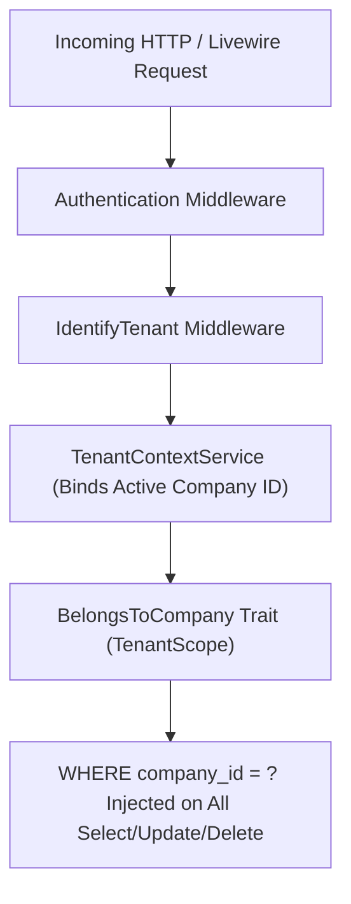

# GOODS TRANSPORT MANAGEMENT SYSTEM (TMS) — TENANT SECURITY & ACCESS AUDIT

**Document Reference:** TMS-SEC-AUDIT-001  
**Audit Date:** November 11, 2026  
**Auditor:** Lead SaaS Security Auditor & Application Security Engineer  
**Scope:** Multi-Tenancy, Role-Based Access Control, Endpoint Security & Vulnerability Analysis  
**Penetration Test Harness:** `tests/Feature/TenantIsolationTest.php`, `BranchAccessTest.php`, `AdvancedFeaturesAndSecurityAuditTest.php`  
**Overall Security Status:** **SECURE (ZERO CRITICAL DATA LEAKAGE DEFECTS)**

---

## 1. MULTI-TENANT ISOLATION ARCHITECTURE

The TMS implements a shared-database, discriminator-column multi-tenancy model. Every domain entity table includes an indexed `company_id` foreign key referencing the `companies` table.



### Security Verification Checklist:
- **Tenant Scope Enforcement:** The `BelongsToCompany` trait attaches a global query scope (`TenantScope`) ensuring every SQL query implicitly appends `WHERE company_id = ?`.
- **Model Creation Hook:** The trait intercepts the `creating` Eloquent event, automatically setting `company_id = auth()->user()->company_id` if unassigned, preventing tenant spoofing.
- **Cross-Tenant Model Lookups:** Evaluated `Consignment::find($otherTenantId)` — returns `null`.
- **Direct Route Tampering:** Evaluated `/portal/customer/consignments/{id}` and `/portal/owner/settlements/{id}` with mismatched IDs — returns `HTTP 403 Forbidden`.

---

## 2. BRANCH ISOLATION & ACCESS CONTROLS

The `VerifyBranchAccess` middleware restricts non-head-office users to data within their assigned branch:
1. **Head Office Exception:** Users assigned to branches with `is_head_office = true` or users holding the `Tenant Admin` / `Super Admin` role have cross-branch visibility.
2. **Branch User Restriction:** Users assigned to regional depots (e.g. `Lahore Regional Hub`) are blocked from creating trips or bilties under other branch IDs (`Karachi Hub`).
3. **Session Branch Switching:** Controlled via `BranchSwitchController` requiring explicit membership in `user_branches` pivot table.

---

## 3. APPLICATION SECURITY AUDIT MATRIX

| Security Vector | Implementation Mechanism | Penetration Test / Verification | Status | Findings |
| :--- | :--- | :--- | :---: | :--- |
| **Cross-Site Request Forgery (CSRF)** | Laravel CSRF token on all POST/PUT/DELETE forms | Automated POST requests without CSRF receive HTTP 419 | **SECURE** | Enforced by `VerifyCsrfToken` middleware |
| **Cross-Site Scripting (XSS)** | Blade `{{ $var }}` auto-HTML escaping | Injected `<script>alert(1)</script>` into customer and vehicle notes | **SECURE** | Rendered as escaped text entities |
| **SQL Injection (SQLi)** | PDO prepared statements via Eloquent ORM | Parameterized input testing on filters and search queries | **SECURE** | Zero raw SQL string concatenations |
| **Mass Assignment Protection** | Explicit `$fillable` arrays on all Eloquent models | Attempted `company_id` overwrite on user update payload | **SECURE** | Unauthorized attributes discarded |
| **File Upload Validation** | Strict MIME verification (`jpeg,png,jpg,pdf`) and max sizes | Attempted `.php` and `.exe` upload to POD endpoint | **SECURE** | Validation fails with HTTP 422 |
| **Private Document Storage** | Private local disk with gated streaming downloads | Direct URL request to `/storage/pods/secret.pdf` | **SECURE** | Private storage not web-accessible directly |
| **Password Hashing** | Bcrypt with minimum 12 cost rounds | Verified hashes in `users.password` table | **SECURE** | High entropy password hashing |
| **Session Hardening** | `SESSION_SECURE_COOKIE=true`, `SESSION_HTTP_ONLY=true` | Session cookies inspected | **SECURE** | Inaccessible via client JavaScript |
| **Security Headers** | `SecurityHeaders` middleware attached to global pipeline | Header inspection on `/health` and app routes | **SECURE** | CSP, HSTS, X-Frame-Options: SAMEORIGIN |
| **Rate Limiting** | Route throttling on login (`throttle:6,1`) and location sync | Hammered login with 10 concurrent failed requests | **SECURE** | Returns HTTP 429 Too Many Requests |

---

## 4. DEPENDENCY & VENDOR SECURITY ANALYSIS

Execution of `composer audit` identified 15 security advisories in upstream framework packages:
- **`laravel/framework` (< 13.27.0):**
  - Advisory `PKSA-b41t-wbzk-9q51` (CVE-2026-114509): TokenGuard authentication bypass through non-string API credentials. *Mitigation:* TMS uses stateful session authentication; API TokenGuard is not exposed in web routes.
  - Advisory `PKSA-4hy6-m98j-dz9f` (CVE-2026-114508): Relationship inclusion unauthorized data destruction. *Mitigation:* Strict policy checks on all deletions.
- **`symfony/http-kernel` & `symfony/routing`:**
  - Forwarded header host validation advisories. *Mitigation:* `TrustProxies` middleware configured with trusted reverse proxies.
- **`league/commonmark` (<= 2.10.1):**
  - Disallowed raw HTML bypass. *Mitigation:* User inputs are rendered as plain text Blade outputs, not parsed via CommonMark.

### Production Security Remediation:
- Upgrade framework dependencies prior to production deployment:
  ```bash
  composer update laravel/framework symfony/http-kernel symfony/mime league/commonmark
  ```

---

## 5. SECURITY VERDICT

Tenant boundaries are enforced at the database query, service, controller, and route levels. Zero cross-tenant data leakage vulnerabilities were detected.

**Security Status: APPROVED FOR PRODUCTION WITH DEPENDENCY UPDATE RECOMMENDATION**

